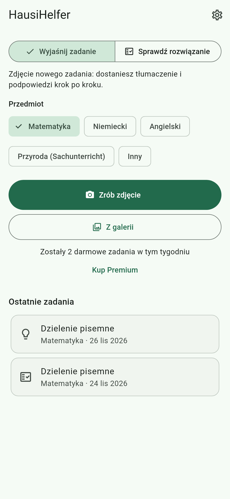
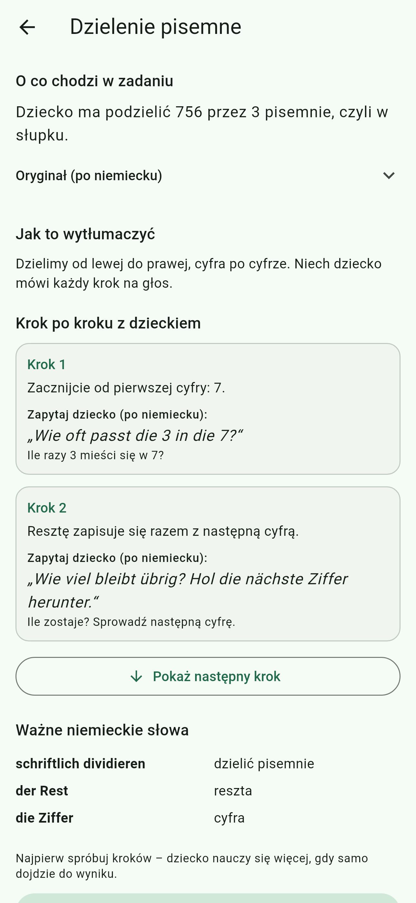
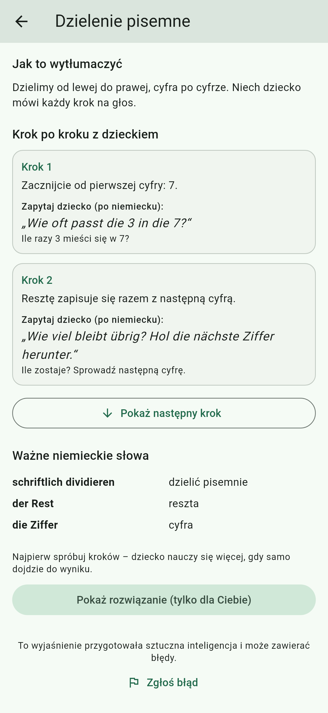

# 📚 HausiHelfer – pomoc w niemieckich zadaniach domowych (Android + iOS)

Aplikacja dla rodziców w Niemczech, szczególnie tych, którzy słabo znają niemiecki.
Rodzic robi zdjęcie zadania, a aplikacja:

1. tłumaczy polecenie na język rodzica,
2. podpowiada, **jak wytłumaczyć** zadanie dziecku,
3. daje **kroki z pytaniami po niemiecku**, które rodzic zadaje dziecku (z tłumaczeniem),
4. pokazuje ważne niemieckie słówka,
5. trzyma **rozwiązanie ukryte** pod przyciskiem (tylko dla rodzica),
6. w trybie **„Sprawdź rozwiązanie”** szuka błędu w zrobionym zadaniu, ale nie podaje wyniku.

Języki: 🇩🇪 niemiecki, 🇵🇱 polski, 🇬🇧 angielski, 🇹🇷 turecki, 🇺🇦 ukraiński, 🇷🇺 rosyjski,
🇸🇦 arabski (układ od prawej do lewej).

| Ekran główny | Wyjaśnienie | Słówka |
|---|---|---|
|  |  |  |

---

## Co jest gotowe

| Część | Stan |
|---|---|
| Aplikacja Flutter: start, zdjęcie, wyjaśnienie, sprawdzanie, historia, paywall, ustawienia | ✅ |
| 7 języków interfejsu i wyjaśnień, arabski od prawej do lewej | ✅ |
| Zakupy (RevenueCat): abonament miesięczny i roczny, przywracanie zakupów, zarządzanie subskrypcją | ✅ |
| Backend: AI, darmowy limit, limit „fair use” w Premium, ochrona przed spamem, zgłoszenia błędów | ✅ |
| Baza danych (SQLite, wbudowana w Node.js): liczniki przetrwają restart | ✅ |
| Strony Impressum / Datenschutz / AGB (szablony po niemiecku, serwowane przez backend) | ✅ do sprawdzenia przez prawnika |
| „Usuń moje dane” w ustawieniach (RODO) | ✅ |
| Ikona aplikacji (Android + iOS) | ✅ |
| Opisy do App Store i Google Play w 7 językach (`store-listing/`) | ✅ |
| Zrzuty ekranów do sklepów w 7 językach (`store-assets/screenshots/`) | ✅ |
| Testy: backend 12, aplikacja 9; CI buduje APK na Androida i wersję na iOS | ✅ |
| Docker + docker-compose z automatycznym HTTPS (Caddy) | ✅ |

**Czego nie da się zrobić za Ciebie** (wymaga Twoich kont, danych lub podpisu): założenie kont
deweloperskich, klucze API, dane firmy do Impressum, wysłanie aplikacji do sklepów. Instrukcja
krok po kroku jest niżej.

---

## Krok po kroku do publikacji

### 1. Konta (ok. 1–2 dni na weryfikację)
- **Google Play Console**: play.google.com/console, jednorazowo 25 USD.
- **Apple Developer Program**: developer.apple.com, 99 USD rocznie. Potrzebny będzie Mac z Xcode albo usługa w chmurze (Codemagic).
- **Anthropic (AI)**: console.anthropic.com. Utwórz klucz API, doładuj konto i ustaw limit wydatków.
- **RevenueCat**: revenuecat.com, darmowe do 2500 USD przychodu miesięcznie.
- **Serwer**: np. Hetzner Cloud (Niemcy), najmniejszy serwer za ok. 4–5 € miesięcznie, plus domena.

### 2. Przetestuj AI na prawdziwych zadaniach (na swoim komputerze)
```bash
cd hausihelfer/backend
npm install
cp .env.example .env              # wpisz ANTHROPIC_API_KEY
npm run try -- zdjecie.jpg pl mathe 3     # zdjęcie, język, przedmiot, klasa
```
Sprawdź 20–30 różnych zadań (matematyka, niemiecki, zdjęcia pisane ręcznie). Każde wywołanie
kosztuje kilka centów. Jeśli jakość jest dobra, wypróbuj tańszy model: `CLAUDE_MODEL=claude-sonnet-5-5`
albo `claude-haiku-5-5` w `.env`.

### 3. Uruchom serwer
Na serwerze z Dockerem:
```bash
git clone <to repozytorium> && cd Coin/hausihelfer/backend
cp .env.example .env      # klucze, dane do Impressum, API_DOMAIN
docker compose up -d      # API + darmowy certyfikat HTTPS
```
W DNS domeny ustaw rekord A dla `api.twojadomena.de` na adres IP serwera.
Sprawdź, czy działają adresy: `https://api.twojadomena.de/health` i `https://api.twojadomena.de/impressum`.

### 4. Subskrypcje
1. **App Store Connect**: utwórz aplikację (bundle ID `de.hausihelfer.hausihelfer`). W sekcji *Subscriptions* utwórz grupę „Premium” z dwiema subskrypcjami:
   - miesięczna `premium_monthly`, 7,99 €,
   - roczna `premium_yearly`, 59,99 €.
   
   Do obu dodaj darmowy okres próbny (*Introductory Offer*): 1 tydzień.
2. **Google Play Console**: utwórz aplikację (pakiet `de.hausihelfer.hausihelfer`) i te same dwie subskrypcje z 7-dniowym okresem próbnym.
3. **RevenueCat**:
   - Dodaj obie aplikacje.
   - Utwórz *Entitlement* o nazwie `premium` i przypisz do niego 4 produkty.
   - Utwórz *Offering* „default” z pakietami *Monthly* i *Annual*.
   - Klucze:
     - publiczne klucze SDK (`appl_…`, `goog_…`) trafiają do aplikacji (krok 5),
     - klucz *Secret API key* trafia do `REVENUECAT_SECRET_KEY` w `.env` serwera.

> Bundle ID / nazwę pakietu możesz zmienić przed pierwszą publikacją (potem już nie).

### 5. Zbuduj aplikację
Potrzebujesz Fluttera 3.50+ (flutter.dev) i Android Studio (z Javą 21; starsza Java psuje budowanie wersji release). Do iOS potrzebny jest Mac z Xcode.

**Android: klucz do podpisywania** (raz, i **zrób kopię zapasową**, bo bez niego nie wydasz aktualizacji):
```bash
keytool -genkey -v -keystore ~/hausihelfer-upload.jks -keyalg RSA -keysize 2048 -validity 10000 -alias upload
```
Utwórz plik `app/android/key.properties` (jest ignorowany przez git):
```
storePassword=...
keyPassword=...
keyAlias=upload
storeFile=/home/ty/hausihelfer-upload.jks
```
Budowanie:
```bash
cd hausihelfer/app
flutter build appbundle \
  --dart-define=API_BASE_URL=https://api.twojadomena.de \
  --dart-define=RC_API_KEY_ANDROID=goog_xxx
# wynik: build/app/outputs/bundle/release/app-release.aab → wgraj do Google Play Console

flutter build ipa \
  --dart-define=API_BASE_URL=https://api.twojadomena.de \
  --dart-define=RC_API_KEY_IOS=appl_xxx
# wynik: build/ios/ipa/*.ipa → wyślij aplikacją Transporter albo z Xcode
```
Przed `flutter build ipa` otwórz `app/ios/Runner.xcworkspace` w Xcode i w *Signing & Capabilities*
wybierz swój *Team* oraz dodaj *In-App Purchase*.

### 6. Opisy, zrzuty ekranów, ankiety o prywatności
- **Teksty**: `store-listing/ios/metadata/<język>/` i `store-listing/android/metadata/<język>/`.
  Możesz je wkleić ręcznie albo wysłać narzędziem fastlane (`fastlane deliver` / `fastlane supply`).
- **Zrzuty ekranów**: `store-assets/screenshots/ios-6.9/<język>/` (App Store) i `android-phone/<język>/` (Google Play).
- **Ikona**: `store-assets/icon-1024.png` (App Store) i `store-assets/icon-512-google-play.png`.
- **Grafika Google Play** (1024×500, *feature graphic*) jest wymagana. Najprościej zrobić ją w Canvie z ikoną i hasłem.
- **Kategoria**: Edukacja. **Nie** zgłaszaj aplikacji do programu „Dla dzieci” / „Designed for Families”, bo aplikacja jest dla rodziców.

**Odpowiedzi do ankiet o prywatności** (App Privacy w App Store, Data safety w Google Play):

| Dane | Zbierane? | Cel | Powiązane z osobą? |
|---|---|---|---|
| Zdjęcia (zadanie domowe) | Tak, przesyłane do przetworzenia, nie są przechowywane | Funkcja aplikacji | Nie |
| Identyfikator urządzenia (losowy, generowany przez aplikację) | Tak | Funkcja aplikacji (limit), zakupy | Nie |
| Historia zakupów | Tak (Apple/Google/RevenueCat) | Funkcja aplikacji | Nie |
| Treść zgłoszenia błędu | Tak, gdy użytkownik je wyśle | Poprawa aplikacji | Nie |
| Śledzenie (tracking), reklamy, lokalizacja, kontakty | **Nie** | – | – |

Dane są szyfrowane w trakcie przesyłania (HTTPS). Użytkownik może usunąć dane w aplikacji.

### 7. Dane prawne
W `.env` serwera uzupełnij `LEGAL_NAME`, `LEGAL_ADDRESS`, `LEGAL_EMAIL`, `LEGAL_PHONE` i
`LEGAL_HOSTER`. Teksty są w `backend/src/legal.ts`. **To szablony.** Przed startem daj je do
sprawdzenia prawnikowi albo wygeneruj w serwisie typu eRecht24 / IT-Recht Kanzlei i podmień treść.
Podpisz też z Anthropic umowę powierzenia danych (DPA). Jest dostępna w panelu konsoli.

---

## Zarabianie i koszty

| Plan | Cena | Co daje |
|---|---|---|
| Darmowy | 0 € | 3 zadania tygodniowo |
| Premium miesięczny | 7,99 € | bez limitu (fair use: 25 dziennie), sprawdzanie rozwiązań |
| Premium roczny | 59,99 € (zaznaczony domyślnie) | to samo, ok. 37% taniej |

- **Prowizja sklepów:** 15% w programach dla małych firm. Trzeba się do nich zgłosić: *App Store Small Business Program* oraz domyślne 15% od subskrypcji w Google Play.
- **Koszt AI:** szacunkowo kilka centów za zadanie przy domyślnym modelu. Zmierz go na swoich testach w console.anthropic.com.
- **Ochrona kosztów** (ustawienia w `.env`):
  - `PREMIUM_PER_DAY`: dzienny limit na jednego użytkownika Premium,
  - `GLOBAL_PER_DAY`: dzienny limit dla wszystkich łącznie, awaryjny bezpiecznik,
  - `IP_LIMIT_PER_10MIN`: limit zapytań z jednego adresu IP,
  - limit wydatków ustaw też w console.anthropic.com.

**Pomysły na pozyskanie użytkowników:**
- grupy na Facebooku „Polacy w Niemczech” i podobne dla innych języków,
- krótkie filmy na TikToku i Instagramie: „Moje dziecko ma takie zadanie z niemieckiego…”,
- polskie i tureckie sklepy, parafie, szkoły sobotnie,
- ogłoszenia w lokalnych grupach rodziców.

---

## Struktura projektu

```
hausihelfer/
├── app/                         aplikacja Flutter (Android + iOS)
│   ├── lib/screens/             ekrany: start, główny, wynik, paywall, ustawienia
│   ├── lib/services/            połączenie z serwerem, zakupy, pamięć w telefonie
│   ├── lib/l10n/app_*.arb       teksty w 7 językach
│   └── test/                    testy + generator zrzutów ekranu (test/screenshots)
├── backend/                     serwer (Node.js + TypeScript)
│   ├── src/explain.ts           zapytanie do AI (zdjęcie → wyjaśnienie)
│   ├── src/prompt.ts            instrukcje dla AI
│   ├── src/quota.ts, db.ts      limity i baza danych
│   ├── src/legal.ts             Impressum, Datenschutz, AGB
│   ├── src/try.ts               test AI na własnym zdjęciu (npm run try)
│   └── Dockerfile, docker-compose.yml
├── store-listing/               teksty do sklepów (format fastlane)
├── store-assets/                ikona i zrzuty ekranów
└── tools/                       skrypty: ikona, teksty do sklepów
```

**Przydatne polecenia:**
```bash
# backend
npm test                 # testy (nie wołają AI, nic nie kosztują)
npm run dev              # serwer lokalnie na :8080
sqlite3 data/hausihelfer.db "select * from reports"    # zgłoszenia błędów od rodziców

# aplikacja
flutter test --exclude-tags screenshots
flutter run --dart-define=API_BASE_URL=http://10.0.2.2:8080   # emulator Androida
# nowe zrzuty ekranu po zmianach w wyglądzie:
FONT_DIR=$(dirname $(which flutter))/cache/artifacts/material_fonts flutter test --update-goldens test/screenshots

# ikona i teksty do sklepów (z folderu hausihelfer/)
python3 tools/make_icons.py
python3 tools/store_listing.py
```

## Pomysły na później
- Firebase App Check / Apple App Attest: lepsza ochrona przed nadużyciami niż losowe ID.
- Czytanie pytań na głos (dla rodziców, którzy nie wiedzą, jak wymówić niemieckie zdanie).
- Więcej języków: rumuński, bułgarski, włoski, kurdyjski, perski.
- Teksty uprawnień iOS (aparat, zdjęcia) w pozostałych językach (`InfoPlist.strings`).
